<div align="center">

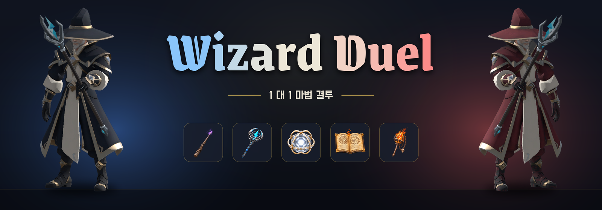

**매번 새로 만들어지는 결투장에서 두 마법사가 맞붙는 1대1 온라인 대전 게임**


[게임 소개](#게임-소개) · [스크린샷](#스크린샷) · [플레이 방법](#플레이-방법) · [무기](#무기) · [맵](#맵) · [AI 대전](#ai-대전) · [시작하기](#시작하기) · [전용 서버](#전용-서버) · [동작 방식](#동작-방식)

</div>

## 게임 소개

Wizard Duel은 두 플레이어가 마법사가 되어 겨루는 쿼터뷰 1대1 대전 게임입니다. 방장이 시드와 형태, 장애물과 부시의 밀도를 고르면 그 설정대로 결투장이 만들어집니다. 두 마법사는 벽 뒤로 피하고 부시에 몸을 숨기며, 상대를 먼저 쓰러뜨리는 쪽이 이깁니다. 서버 없이 즐기는 AI 대전에서는 30초마다 새 무기가 맵에 떨어져 판의 흐름을 바꿉니다.

<table>
<tr>
<td width="33%" valign="top"><b>랜덤한 전장</b><br>방을 열 때마다 새로운 전장이 만들어집니다. 형태도, 벽과 부시의 배치도 매번 달라집니다.</td>
<td width="33%" valign="top"><b>코드 입력을 통한 온라인 접속</b><br>6자리 코드로 방을 만들고 참가합니다. 서버 하나가 여러 방을 동시에 엽니다.</td>
<td width="33%" valign="top"><b>무기 5종</b><br>마력탄, 번개, 반사되는 빛줄기, 폭발, 화염까지 공격 방식이 모두 다릅니다. 두 개까지 들고 바꿔 씁니다.</td>
</tr>
<tr>
<td valign="top"><b>부시 은신</b><br>부시에 들어가면 상대 화면에서 사라집니다. 공격하면 잠깐 모습이 드러납니다.</td>
<td valign="top"><b>AI 대전</b><br>서버 없이 세 가지 난이도의 AI와 바로 한 판 겨룹니다.</td>
<td valign="top"><b>끊임없는 재도전</b><br>승부가 나면 같은 방의 로비 화면으로 돌아와 설정을 바꾸고 다시 시작합니다.</td>
</tr>
</table>

## 스크린샷

<p align="center">
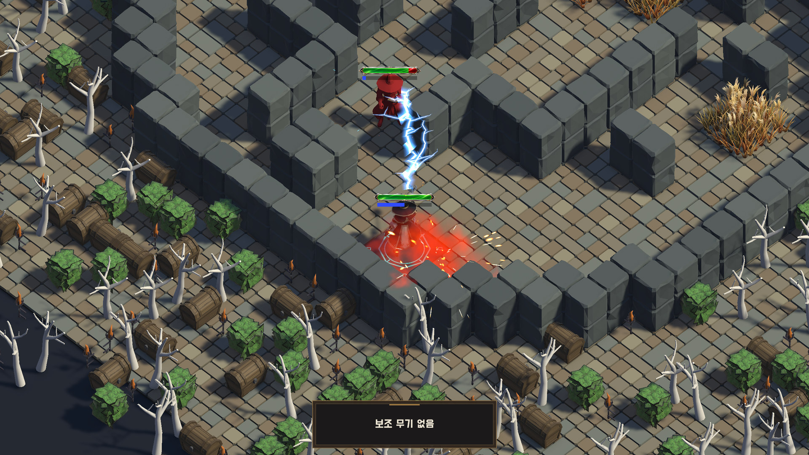
</p>

<table>
<tr>
<td width="50%" valign="top">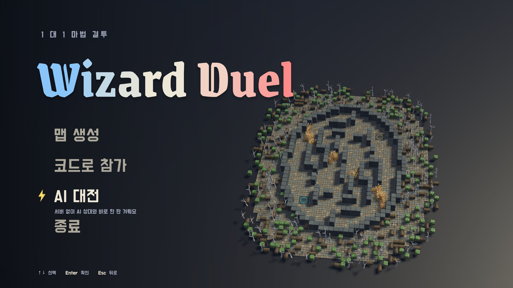<br><b>시작 화면</b><br><sub>메뉴 뒤로 미리보기 결투장이 천천히 돌아갑니다.</sub></td>
<td width="50%" valign="top">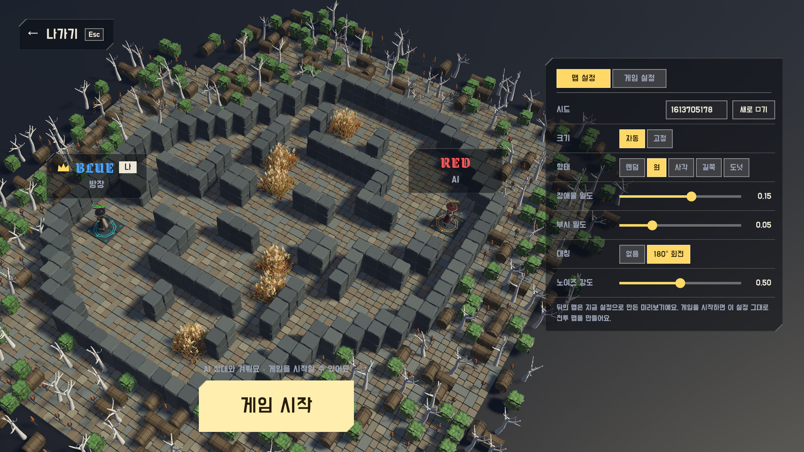<br><b>로비 화면 · 맵 설정</b><br><sub>설정을 바꾸면 뒤에 깔린 미리보기 맵이 바로 다시 만들어집니다.</sub></td>
</tr>
<tr>
<td valign="top">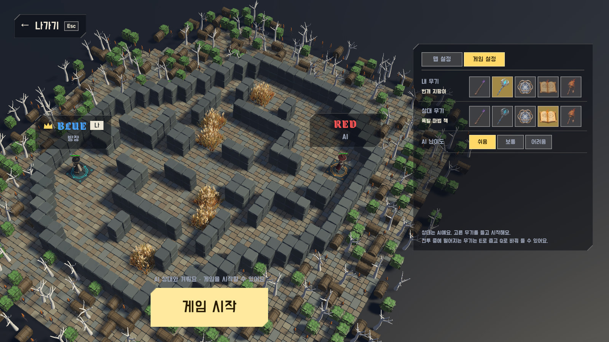<br><b>로비 화면 · 게임 설정</b><br><sub>AI 대전에서는 내 무기와 상대 무기, 난이도를 고릅니다.</sub></td>
<td valign="top">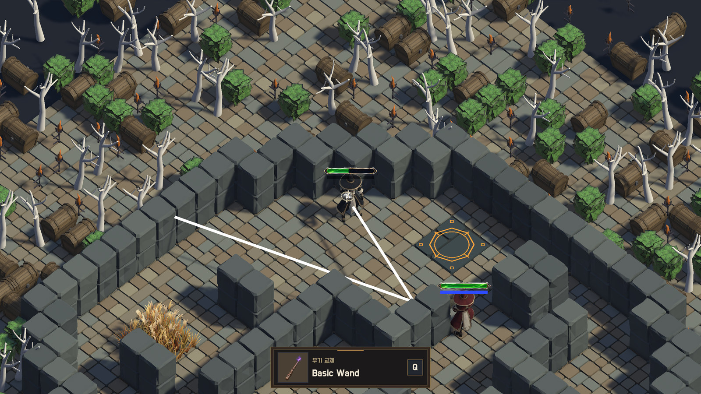<br><b>빛 반사 구슬</b><br><sub>벽에 튕긴 빛줄기로 엄폐물 너머의 상대를 노립니다.</sub></td>
</tr>
<tr>
<td valign="top">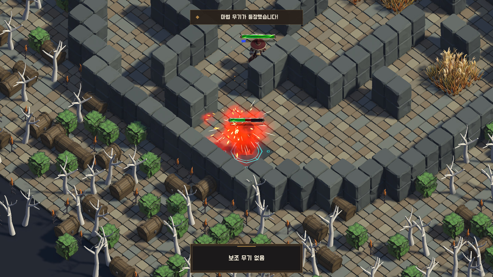<br><b>무기 등장</b><br><sub>새 무기가 떨어지면 화면 위쪽에 알림이 뜹니다.</sub></td>
<td valign="top">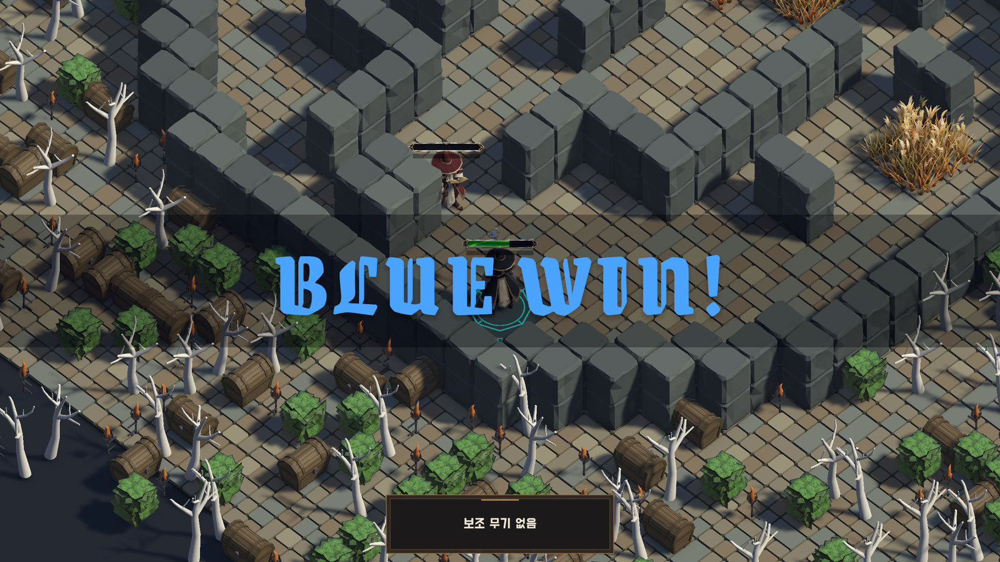<br><b>승자 표시</b><br><sub>승부가 나면 3초 뒤 같은 로비 화면으로 돌아갑니다.</sub></td>
</tr>
</table>

<sub>모두 Unity 에디터에서 AI 대전으로 찍은 화면입니다.</sub>

## 플레이 방법

### 게임 흐름

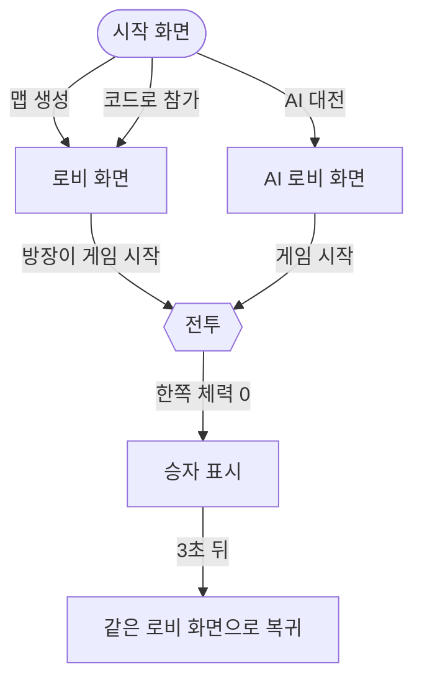

1. **맵 생성**을 누르면 방이 열리고 6자리 맵 코드가 나옵니다. 상대는 **코드로 참가**에서 이 코드를 입력합니다.
2. 로비 화면에서 방장이 맵 설정을 바꾸면 뒤에 깔린 미리보기 맵과 상대 화면에 바로 반영됩니다.
3. 두 명이 모이면 방장이 **게임 시작**을 누릅니다. 방장은 파랑(1P), 참가자는 빨강(2P)입니다.
4. 상대를 먼저 쓰러뜨리면 승리합니다. 승자가 표시된 뒤 같은 방의 로비 화면으로 돌아옵니다.

### 조작법

| 입력 | 동작 |
|---|---|
| <kbd>W</kbd> <kbd>A</kbd> <kbd>S</kbd> <kbd>D</kbd> | 이동 |
| 마우스 이동 | 조준 |
| 마우스 왼쪽 버튼 | 공격. 번개 지팡이는 누르고 있는 동안 충전하고 떼면 발사 |
| <kbd>E</kbd> | 가까이 떨어진 무기 줍기 |
| <kbd>Q</kbd> | 들고 있는 두 무기 바꿔 들기 |
| <kbd>Esc</kbd> | 메뉴에서 뒤로, 로비 화면 나가기, AI 대전 그만두기 |

메뉴는 <kbd>↑</kbd> <kbd>↓</kbd>로 고르고 <kbd>Enter</kbd>로 확인합니다. 공격 모션 중에는 움직일 수 없고, 무기마다 재사용 대기 시간이 있습니다. 남은 대기 시간은 체력바 아래 막대로 보입니다.

## 무기

<table>
<tr>
<th width="76"></th>
<th width="124">무기</th>
<th width="258">공격 방식</th>
<th>특징</th>
</tr>
<tr>
<td align="center">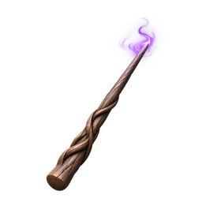</td>
<td><b>기본 완드</b></td>
<td>마력탄을 곧게 발사</td>
<td>처음부터 들고 있는 무기. 맵에는 떨어지지 않음</td>
</tr>
<tr>
<td align="center">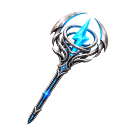</td>
<td><b>번개 지팡이</b></td>
<td>충전한 뒤 일직선으로 뻗는 번개</td>
<td>오래 충전할수록 사거리와 피해가 커짐. 쏘는 순간 끝까지 닿음</td>
</tr>
<tr>
<td align="center">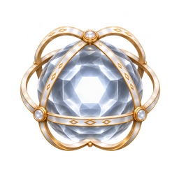</td>
<td><b>빛 반사 구슬</b></td>
<td>벽에 반사되는 빛줄기</td>
<td>반사할 때마다 피해가 커짐. 벽 뒤의 상대를 노릴 수 있음</td>
</tr>
<tr>
<td align="center">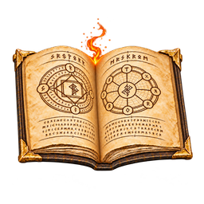</td>
<td><b>폭발 마법 책</b></td>
<td>날아가서 터지는 화염 공</td>
<td>벽이나 상대에 닿거나 사거리 끝에 이르면 폭발해 주변에 피해</td>
</tr>
<tr>
<td align="center">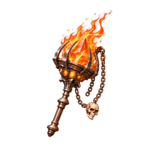</td>
<td><b>화염 향로</b></td>
<td>눈앞을 부채꼴로 휩쓰는 근접 공격</td>
<td>맞은 상대에게 화상과 둔화. 들고 있는 동안 이동이 빨라짐</td>
</tr>
</table>

- 전투가 시작되고 30초 뒤에 첫 무기가 떨어지고, 그 뒤로 30초마다 하나씩 더 떨어집니다. 무기가 떨어지면 화면 위쪽에 알림이 뜹니다.
- 무기는 두 개까지 들 수 있습니다. 두 칸이 모두 찬 상태에서 주우면 손에 든 무기와 바뀝니다.
- 무기 스폰은 지금 **AI 대전에서만** 열립니다. 전용 서버로 하는 온라인 대전에서는 아직 무기가 떨어지지 않습니다.
- 피해량과 사거리 같은 수치는 각 무기 프리팹(`Assets/Game/Weapons/`)에서 조정합니다.

## 맵

결투장은 시드와 몇 가지 설정만으로 만들어집니다. 아래는 모두 시드 `7301`로 만든 맵입니다.

<p align="center">
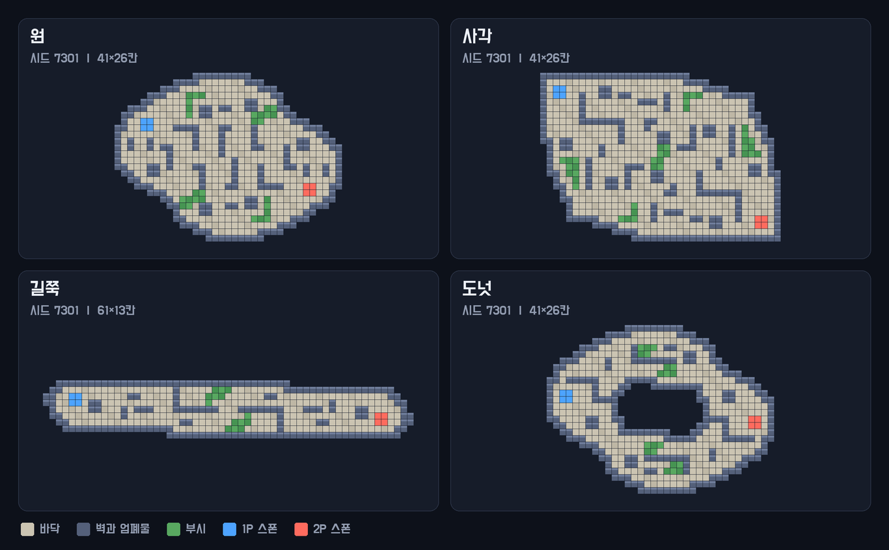
</p>

같은 시드라도 설정을 바꾸면 전혀 다른 판이 됩니다.

<p align="center">
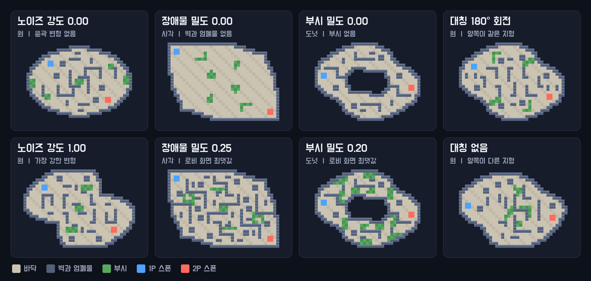
</p>

| 설정 | 범위 | 설명 |
|---|---|---|
| 시드 | 정수 | 같은 시드와 설정이면 언제나 같은 맵. **새로 뽑기**로 무작위 시드를 받음 |
| 크기 | 자동 / 고정 25~61칸 | 자동은 형태에 맞는 크기를 시드로 정함 |
| 형태 | 랜덤 · 원 · 사각 · 길쭉 · 도넛 | 랜덤은 시드가 형태를 고름 |
| 장애물 밀도 | 0 ~ 0.25 | 벽과 엄폐물이 들어서는 정도 |
| 부시 밀도 | 0 ~ 0.20 | 몸을 숨길 부시가 깔리는 정도 |
| 대칭 | 없음 / 180° 회전 | 180° 회전이면 두 스폰에서 본 맵이 같음 |
| 노이즈 강도 | 0 ~ 1 | 맵 윤곽을 얼마나 울퉁불퉁하게 만들지 |

- 스폰 지점 주변은 항상 비워 두어 시작하자마자 벽에 갇히는 일이 없습니다.
- 모든 바닥은 서로 이어져 있어 들어갈 수 없는 구역이 생기지 않습니다.
- 맵 생성기는 별도 어셈블리(`WizardDuel.MapGeneration`)로 분리되어 있고, 생성 규칙은 [맵 생성 문서](Assets/Map/Generation/README.md)에 정리되어 있습니다.

## AI 대전

시작 화면에서 **AI 대전**을 고르면 서버에 접속하지 않고 AI 상대와 겨룹니다. AI 로비 화면에서 맵 설정과 함께 내 무기, 상대 무기, 난이도를 고릅니다. 전투 규칙과 판정은 온라인 대전과 같은 코드로 동작하고, 전투 중에 떨어지는 무기도 주워 쓸 수 있습니다.

| 난이도 | 반응 시간 | 조준 오차 | 공격을 피할 확률 | 벽 뒤로 숨을 확률 |
|---|:---:|:---:|:---:|:---:|
| 쉬움 | 0.6초 | 최대 14° | 15% | 20% |
| 보통 | 0.35초 | 최대 6° | 50% | 60% |
| 어려움 | 0.2초 | 최대 2.5° | 85% | 90% |

## 시작하기

### 준비물

- Unity **6000.3.24f1** (Unity Hub에서 설치)
- Git

### 에디터에서 실행

```bash
git clone git@github.com:rkwnsdud/Wizard-Duel.git
```

1. Unity Hub에서 받은 폴더를 프로젝트로 엽니다.
2. `Assets/Scenes/Main.unity`를 열고 Play를 누릅니다.
3. **AI 대전**은 이 상태에서 바로 할 수 있습니다. 온라인 대전은 아래처럼 서버를 먼저 띄워야 합니다.

### 내 PC에서 1대1 해 보기

에디터 메뉴 **Tools > Wizard Duel > Network Test** 창에서 서버와 클라이언트를 한 번에 띄울 수 있습니다.

1. **Mode**를 `Main`으로 둡니다.
2. **Build**를 눌러 `Build/LobbyTest/WizardDuel.exe`를 만듭니다.
3. **1v1**을 누르면 서버 하나와 클라이언트 창 두 개가 뜹니다. 한쪽에서 맵을 생성하고 다른 쪽에서 코드로 참가합니다.

실행 기록은 `Logs/LobbyTest/`에 남고, **Open Logs**로 바로 열 수 있습니다.

<details>
<summary>실행 파일을 직접 띄우는 방법</summary>

<br>

```bash
# 전용 서버 (UDP 7777)
WizardDuel.exe -batchmode -nographics -server -logFile server.log

# 클라이언트
WizardDuel.exe -join 127.0.0.1 -screen-fullscreen 0 -screen-width 1280 -screen-height 720
```

| 인자 | 설명 |
|---|---|
| `-server` | 전용 서버로 실행. 화면 없이 방 생성과 참가 요청을 받음 |
| `-join <주소>` | 접속할 서버 주소. IP와 도메인 모두 가능하고, 생략하면 `127.0.0.1` |

</details>

## 전용 서버

리눅스 서버에서는 Docker로 전용 서버를 빌드하고 실행합니다. Unity 라이선스 파일 준비 같은 첫 설정은 [서버 배포 문서](Deploy/Server/README.md)를 따릅니다.

```bash
bash Deploy/Server/build.sh
```

- `main` 브랜치를 최신으로 받은 뒤 Linux Dedicated Server로 빌드해 컨테이너로 띄웁니다.
- UDP 7777 포트를 쓰고, 서버가 죽으면 자동으로 다시 뜹니다.
- 서버 하나가 방을 최대 50개까지 동시에 엽니다.
- 클라이언트는 `WizardDuel.exe -join <서버 주소>`로 접속합니다. 서버와 같은 커밋으로 빌드한 클라이언트여야 접속이 거절되지 않습니다.

## 동작 방식

온라인 대전은 전용 서버가 방과 전투를 관리합니다. 맵 데이터를 통째로 보내는 대신 설정만 주고받아 서버와 두 클라이언트가 각자 맵을 만들고, 결과가 같은지 지문(SHA-256)으로 확인한 뒤에 플레이어를 소환합니다.

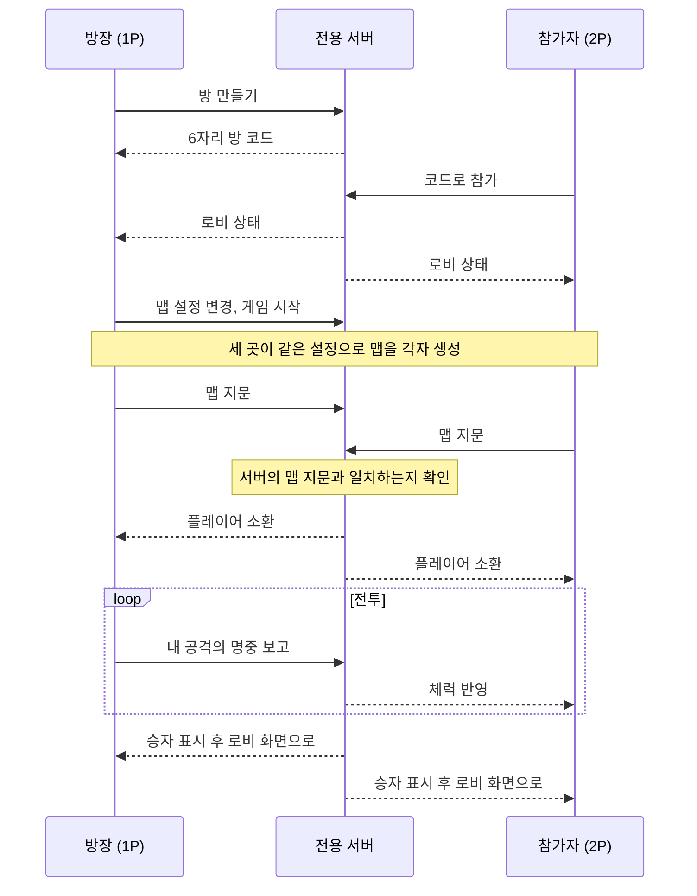

- **명중 판정**은 공격한 쪽 클라이언트가 하고, **체력**은 서버가 관리합니다. 조준한 대로 맞는 손맛을 살리면서 체력과 승패는 한곳에서 정합니다.
- **무기 스폰과 인벤토리**는 서버 권한으로 처리합니다. 줍기와 교체는 요청을 보내 확인받은 뒤에 반영됩니다. 다만 스폰은 맵을 직접 세워 두는 쪽에서만 열리기 때문에, 맵을 지문만 뽑고 지우는 전용 서버에서는 아직 열리지 않고 AI 대전의 호스트에서만 동작합니다.
- **부시 시야**는 각 화면에서 따로 계산합니다. 숨은 상대는 그리지 않을 뿐이고, 충돌과 위치 동기화는 그대로입니다.

## 프로젝트 구조

직접 만든 에셋과 스크립트는 기능별 PascalCase(띄어쓰기 없음) 폴더 아래에 모으고, 외부 에셋 팩은 `Assets/ThirdParty/`에 분리합니다.
- 독립 기반 모듈(`Audio`, `Effects`, `Input`, `Map`)과 핵심 게임플레이(`Game/<기능>/`) 아래에 각 기능의 `Scripts/`, `Prefabs/`, `Art/`, `Audio/`, `Editor/`를 모아 한 기능을 수정할 때 볼 곳을 한 군데로 모읍니다. (여러 기능에 걸친 게임플레이 공통 코드는 `Assets/Game/Common/`, 공통 에디터 도구는 `Assets/Editor/`에 둡니다.)
- 외부 에셋 팩은 `Assets/ThirdParty/<팩이름>/` 아래에 원본 내부 구조 그대로 분리합니다.
- 단, `Assets/TextMesh Pro/`는 UGUI 패키지가 `Assets/TextMesh Pro/Resources/TMP Settings.asset` 경로를 고정으로 검사하므로 루트에 유지하고, UI에서 직접 생성해 쓰는 TMP SDF 폰트와 글꼴 원본은 `Assets/Game/UI/Fonts/`에 둡니다.
- `Assets/DefaultNetworkPrefabs.asset`(NGO 기본 생성 경로), `Assets/Scenes/`(빌드·서버 배포 경로), `Assets/Settings/`(URP·카메라 설정)는 루트 아래 현 위치를 유지합니다.
- 모든 테스트(`*Tests.cs`), 테스트 실행기(`TestSuites`), 픽스처는 `Assets/Tests/Editor/<기능>/`와 `Assets/Tests/Runtime/`에 모아 런타임 코드와 분리합니다.

```text
Wizard-Duel/
├─ Assets/
│  ├─ Audio/                  효과음 라이브러리(Resources/SfxLibrary), 클립, 재생 스크립트, SfxPanel (WizardDuel.Audio)
│  ├─ Effects/                재사용 가능한 독립 이펙트(Lightning) (WizardDuel.Effects)
│  ├─ Game/                   서로 참조하는 핵심 게임플레이(WizardDuel.Game 단일 게임 어셈블리 경계)
│  │  ├─ Common/              카메라 추적 등 기능 공통 코드
│  │  ├─ Battle/              전투 진행(DuelArena, DuelPlayer), 봇(AI), 무기 스폰
│  │  ├─ Lobby/               방 목록과 세션, 로비 네트워크(LobbyNetwork)
│  │  ├─ Main/                시작·로비 화면, 설정 패널, 전용 서버 빌드(Editor)
│  │  ├─ Player/              마법사 프리팹, 이동·조준·공격·체력·상태이상, 캐릭터 아트·셰이더
│  │  ├─ UI/                  전투 HUD, UI 아트·아이콘, UI 글꼴(Fonts)
│  │  └─ Weapons/             무기 5종(BasicWand, ExplosionMagicBook, FireCenser, LightningStaff, LightOrb), 공통 계약(Common), 정의(Definitions)
│  ├─ Input/                  PlayerInputActions 입력 액션과 생성 래퍼 (WizardDuel.Input)
│  ├─ Map/                    맵 조립, 블록, 배경, 맵 지문, 바닥·벽·부시·스폰 프리팹·아트 (WizardDuel.Map)
│  │  └─ Generation/          맵 생성기(WizardDuel.MapGeneration)
│  ├─ Scenes/                 게임 본편(Main)과 오프라인 테스트 씬(DuelOfflineTest)
│  ├─ Settings/               URP 파이프라인·렌더러·볼륨 프로필·카메라 설정
│  ├─ TextMesh Pro/           TMP 기본 리소스(패키지 경로 고정 제약으로 루트 유지)
│  ├─ ThirdParty/             외부 에셋 팩(BasicMan, DanielMistage, EricVFXStudio, MagicEffectsPack, MapParts)
│  ├─ Editor/                 여러 기능에 걸친 에디터 도구(NetworkTestWindow, WeaponHudIconBaker, NetworkPrefabHashRepair) (WizardDuel.Editor)
│  └─ Tests/                  테스트 실행기(TestSuites)와 기능별 EditMode·런타임 테스트 (WizardDuel.EditorTests, WizardDuel.RuntimeTests, WizardDuel.MapGeneration.EditorTests)
├─ Deploy/Server/             리눅스 전용 서버 Docker 배포
├─ Docs/                      기능별 설계·검증 문서
└─ Tools/                     모델·애니메이션 보조 스크립트
```

## 개발 인원

<table>
<tr>
<td align="center" valign="top" width="33%">
<a href="https://github.com/YubinMoon"><br><b>YubinMoon</b></a>
</td>
<td align="center" valign="top" width="33%">
<a href="https://github.com/rkwnsdud"><br><b>rkwnsdud</b></a>
</td>
<td align="center" valign="top" width="33%">
<a href="https://github.com/Without03"><br><b>Without03</b></a>
</td>
</tr>
<tr>
<td align="center" valign="top">
맵 생성<br>
네트워크와 전용 서버<br>
시작 화면과 로비 화면<br>
AI 대전<br>
부시 은신<br>
폭발 마법 책
</td>
<td align="center" valign="top">
캐릭터와 무기 분리<br>
기본 완드<br>
번개 지팡이<br>
빛 반사 구슬<br>
체력바<br>
무기 스폰과 인벤토리
</td>
<td align="center" valign="top">
전장 배경<br>
스폰 이펙트<br>
무기 패시브와 쿨다운 UI<br>
상태이상<br>
화염 향로
</td>
</tr>
</table>

## 사용한 에셋

<table>
<tr>
<th width="96">종류</th>
<th>에셋과 출처</th>
</tr>
<tr>
<td align="center"><b>이펙트</b></td>
<td>
Free Game VFX (Eric VFX Studio)<br>
Magic effects pack
</td>
</tr>
<tr>
<td align="center"><b>모델</b></td>
<td>
마법사, 기본 완드: Meshy AI로 생성<br>
화염 향로: Stylized Fantasy Armory (Daniel Mistage)
</td>
</tr>
<tr>
<td align="center"><b>글꼴</b></td>
<td>
<a href="https://fonts.google.com/specimen/Grenze+Gotisch">Grenze Gotisch</a>, <a href="https://fonts.google.com/specimen/Do+Hyeon">Do Hyeon</a> (SIL Open Font License)
</td>
</tr>
<tr>
<td align="center"><b>효과음</b></td>
<td>
Pixabay 음원과 직접 합성한 소리<br>
출처와 라이선스: <a href="Docs/BasicWand/ArcaneBolt_Fire_License.md">기본 완드 발사음</a> · <a href="Assets/Audio/Clips/Inventory/LICENSE.txt">무기 줍기</a> · <a href="Assets/Audio/Clips/Notifications/LICENSE.txt">무기 등장 알림</a>
</td>
</tr>
</table>
